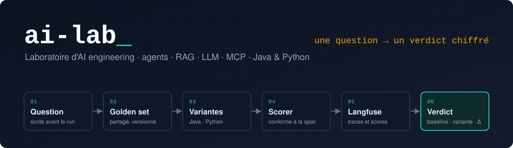

<p align="center">
  
</p>

<p align="center">
  
  
  
  
  
  
  
  
  
</p>

# ai-lab

Laboratoire d'AI engineering : des expériences ciblées, mesurées et reproductibles sur les agents, le RAG et les LLM, en Java (Spring Boot, Spring AI) et en Python (SDK MCP, FastAPI).

Ce dépôt n'est pas un catalogue de démos. Chaque expérience pose une question, la teste contre une baseline et se conclut par un chiffre.

## Thèse

Les choix d'architecture d'un système à base de LLM (forme des outils, découpage des documents, stratégie de récupération, rédaction des prompts) se décident souvent à l'intuition. Ils se mesurent.

Ce lab traite ces choix comme des hypothèses : une question, un protocole écrit avant de lancer quoi que ce soit, un jeu d'évaluation versionné, et un verdict chiffré. Le verdict est publié même quand l'hypothèse est réfutée.

## Règles du lab

1. **Une expérience répond à une seule question.** Elle se conclut par un verdict chiffré (baseline, variante, delta), avec la dispersion mesurée sur plusieurs répétitions. Une expérience qui compare plusieurs leviers se découpe en étapes, une par levier, chacune jugée contre une baseline gelée ; son verdict est le tableau des deltas.
2. **Le protocole est écrit avant les résultats.** Chaque expérience suit le gabarit [`experiments/_template`](experiments/_template/README.md) : Question · Hypothèse · Protocole · Discipline d'itération · Mesures · Résultats · Verdict · Limites.
3. **On itère sur `dev`, on juge sur `test`.** Les variantes reçoivent le même effort d'itération, sont gelées par un commit, puis passent un seul run final sur le split `test`.
4. **Les domaines sont séparés des expériences.** Un domaine (`domains/<nom>/`) regroupe ses données et ses jeux d'évaluation. Plusieurs expériences peuvent tourner sur le même domaine, et chacune indique les siens dans son README.
5. **L'évaluation est commune par sa spec, pas par son code.** Voir [Évaluation](#évaluation).
6. **Un jeu de données publié ne change plus.** Pour le corriger, on crée `v2`. Une version est considérée comme publiée dès qu'un rapport de résultats la cite.
7. **Les données sont synthétiques ou publiques.** Synthétiques, elles sont produites par des scripts seedés et versionnés. Publiques, elles sont sous une licence compatible avec un dépôt public, et le README du domaine cite la source, la licence et la date d'extraction. Aucune donnée client, dans les deux cas.
8. **Les comparaisons se font à modèle constant.** Les deltas sont calculés modèle par modèle. Les tokens ne sont jamais comparés d'un fournisseur à l'autre, car leurs tokenizers diffèrent.

## Évaluation

Le principe est celui d'une suite de conformance, comme [JSON-Schema-Test-Suite](https://github.com/json-schema-org/JSON-Schema-Test-Suite) ou la [conformance MCP](https://github.com/modelcontextprotocol/conformance) : les données et les règles sont partagées, le code est propre à chaque langage.

- **Partagé :** les golden sets (JSONL validé par JSON Schema), les règles de notation (`SPEC.md`) et des **vecteurs de conformance**, c'est-à-dire des cas de notation accompagnés de leurs scores attendus.
- **Propre à chaque langage :** le scorer. En Java, il tourne dans JUnit. En Python, c'est une métrique personnalisée DeepEval. Les deux doivent passer les mêmes vecteurs : c'est ce qui garantit qu'ils notent de la même façon.
- **Restitution :** les traces et les scores remontent dans Langfuse (auto-hébergé) pour comparer les runs. Les rapports Markdown datés restent dans `results/`, pour que tout soit rejouable sans compte.

Une spec versionnée suit la même règle que les données : une fois publiée, elle ne change plus ; une correction donne une `v2`.

**Exemple de golden set : [`rag-qa`](domains/droit-consommation/golden/rag-qa/README.md)** (droit de la consommation, v4, 339 questions). Il comprend neuf types de questions inspirés de benchmarks RAG publics (CRAG, MultiHop-RAG) : question directe, paraphrase, contexte perdu, plusieurs articles, comparaison, liste, fausse prémisse, question sans réponse… Les articles sont tirés par un script seedé, et non choisis par le LLM rédacteur. Chaque item est relu sur tout le corpus, preuves copiées mot pour mot à l'appui. Les questions sans réponse sont auditées, et les défauts connus sont écrits dans ses limites.

## Expériences

### Par aspect

| Aspect | Expérience | Statut |
|---|---|---|
| Design d'outils MCP | [001 — Outils par intention ou miroir REST ?](experiments/001-mcp-outils-par-intention/README.md) | Terminée : B meilleure de +24,6 pts avec Mistral small ; non concluant (plafond) avec Gemini Flash-Lite et Claude Haiku 5.5 |
| RAG | [002 — Notre RAG répond mal : quels sont les plus gros leviers ?](experiments/002-leviers-rag/README.md) | 5 étapes conclues : le RAG naïf (+37 à +44 pts), puis 20 passages (+7 à +8 pts pour deux modèles sur trois) ; reformulation et reclassement non concluants ; consigne d'abstention selon le modèle. Run consolidé sur le golden set v4 : protocole écrit, lanceur en cours d'écriture |

### Par domaine

| Domaine | Contenu | Expériences |
|---|---|---|
| [magasin](domains/magasin/README.md) | Catalogue d'environ 50 produits, 5 magasins, stocks (synthétiques) | 001 |
| [droit-consommation](domains/droit-consommation/README.md) | Code de la consommation, 2 150 articles en vigueur au 13/07/2025 (LEGI, Licence Ouverte) ; golden set de 200 questions (v1), étendu à 339 (v4) | 002 (étapes 1 à 5) |

## Résultats clés

Chaque ligne renvoie au rapport daté qui l'a produite.

**001 — Outils par intention ou miroir REST ?**

| Expérience | Modèle | Mesure | Baseline | Variante | Delta [IC 95 %] | Verdict |
|---|---|---|---|---|---|---|
| [001](experiments/001-mcp-outils-par-intention/results/2026-11-04-run-final-test.md) | `mistral-small-2603` | `success` | 0,742 | 0,988 | +0,246 [+0,160 ; +0,332] | B meilleure |
| [001](experiments/001-mcp-outils-par-intention/results/2026-11-04-run-final-test.md) | `gemini-3.5-flash-lite` | `success` | 0,994 | 1,000 | +0,006 [−0,006 ; +0,018] | non concluant |
| [001](experiments/001-mcp-outils-par-intention/results/2026-11-04-run-final-test.md) | `claude-haiku-5-5` | `success` | 0,996 | 1,000 | +0,004 [−0,002 ; +0,010] | non concluant |

**002 — Les leviers du RAG**, un delta par levier et par modèle (variante − baseline, IC à 95 %, golden set `rag-qa` v1 pour les étapes 1 à 4, v3 pour l'étape 5) :

| Levier (étape) | Baseline | Mesure | `mistral-small-2603` | `ministral-14b-2512` | `gemini-3.5-flash-lite` |
|---|---|---|---|---|---|
| [RAG naïf, 5 passages (1)](experiments/002-rag-naif-vs-modele-seul/results/2026-11-07-run-final-test.md) | modèle seul | `correct` | **+0,373** [+0,276 ; +0,470] | **+0,442** [+0,354 ; +0,531] | **+0,367** [+0,273 ; +0,460] |
| [Reformulation de la question (2)](experiments/003-reformulation-de-requete/results/2026-11-08-run-final-test.md) | RAG naïf | `correct` | −0,009 [−0,059 ; +0,042] | −0,007 [−0,062 ; +0,049] | −0,009 [−0,059 ; +0,041] |
| [20 passages au lieu de 5 (3)](experiments/004-top-k-20/results/2026-11-08-run-final-test.md) | RAG naïf | `correct` | +0,040 [−0,016 ; +0,096] | **+0,073** [+0,019 ; +0,128] | **+0,080** [+0,030 ; +0,130] |
| [Reclassement, 50 candidats vers 5 (4)](experiments/005-reclassement/results/2026-11-09-run-final-test.md) | 20 passages | `correct` | −0,013 [−0,056 ; +0,029] | −0,004 [−0,056 ; +0,047] | −0,020 [−0,065 ; +0,025] |
| [Consigne d'abstention (5)](experiments/006-consigne-abstention/results/2026-11-09-run-final-test.md) | 20 passages | `hallucination` (↓) ; garde `false_abstention` | **−0,092** [−0,157 ; −0,026], garde tenue | −0,052 [−0,135 ; +0,030] | garde franchie : `false_abstention` **+0,087** [+0,032 ; +0,141] |

En gras : delta concluant. Les autres sont non concluants. Le [run consolidé](experiments/002-leviers-rag/README.md#run-consolidé-sur-le-golden-set-v4) mesurera tous les leviers dans un même run, sur le golden set v4.

## Organisation du dépôt

```
ai-lab/
├── evals/
│   ├── spec/       # par famille et par version : SPEC.md, JSON Schema, vecteurs de conformance
│   ├── java/       # scorer Java (JUnit), testé contre les vecteurs
│   └── python/     # scorer Python (métrique DeepEval), testé contre les vecteurs
├── rag/python/     # briques RAG communes aux étapes de l'expérience 002 (corpus, embeddings, recherche) : baseline naïve, leviers en option
├── domains/        # un dossier par domaine : données versionnées, golden sets, générateur seedé
└── experiments/    # une expérience par dossier : cadrage, implémentations (java/, python/), results/
```

## Stack

**Java**

| Composant | Version |
|---|---|
| Java | 25 (LTS), via une toolchain Gradle |
| Build | Gradle 9.8.2, Kotlin DSL, multi-module |
| Spring Boot | 4.1.1 |
| Spring AI | 2.0.1 (starter MCP Server WebMVC, transport Streamable HTTP) |
| SDK MCP Java | 2.1.0, imposée à la place de la 2.0.0 tirée par Spring AI (compatibilité à valider par un test de démarrage) |
| Évaluation | JUnit, scorer conforme à la spec ; Apache Commons Statistics 1.3 (loi de Student) et ICU4J 78.3 (casefold Unicode complet) |

**Python**

Côté Python, aucune bibliothèque ne couvre seule le périmètre de Spring AI : chaque rôle a sa propre bibliothèque.

| Rôle | Choix | Version |
|---|---|---|
| Runtime et workspace | Python, uv | 3.13 |
| Serveurs MCP | SDK MCP Python officiel (embarque Starlette et uvicorn, sans FastAPI) | 2.3.0 |
| API HTTP, quand une expérience en expose une | FastAPI | 0.159.0 |
| Boucle d'agent, client LLM et MCP | Pydantic AI (Gemini, Mistral, Claude et MCP en extras), retenu pour la 001 après le test exploratoire | 2.65.0 |
| Tests et qualité | pytest, ruff | 9.1.1 · 0.17.1 |
| Évaluation | DeepEval, avec une métrique personnalisée conforme à la spec | 4.3.1 |

**Commun**

| Composant | Choix |
|---|---|
| Fournisseurs LLM | Gemini, Mistral, Claude (starters Spring AI côté Java ; SDK côté Python à choisir) |
| Golden sets et specs | JSONL et JSON Schema, lisibles depuis les deux langages |
| Traces et scores | Langfuse 4.74.0, auto-hébergé (`infra/langfuse/`, Docker Compose, sur `127.0.0.1`) |

Versions vérifiées le 2026-10-21 sur Maven Central, PyPI, GitHub et services.gradle.org.

Point d'attention sur la spec MCP : le SDK Python 2.3.0 supporte la révision `2026-07-28` (cœur sans état, `server/discover`). La pile Java s'arrête à la révision `2025-11-25`. Le détail est dans la section Limites de l'expérience 001.

Les serveurs MCP du laboratoire suivent un référentiel commun, sourcé et daté : [bonnes pratiques MCP](docs/mcp-bonnes-pratiques.md). Il sépare les exigences de la spec (conception des réponses et des erreurs, sécurité du transport, authentification OAuth 2.1) des recommandations de praticiens, que les expériences mettent à l'épreuve.

## Reproduire

Prérequis : un JDK 25 (sinon Gradle le télécharge) et [uv](https://docs.astral.sh/uv/).

```bash
cp .env.example .env      # renseigner les clés API ; .env n'est jamais versionné
./gradlew build           # implémentations et scorer Java, dont les tests de conformance
uv sync                   # workspace Python
uv run pytest             # scorer Python (dont la conformance), générateurs de données, implémentations
uv run ruff check
```

La procédure propre à chaque expérience (lancement des variantes, notation, rapport) est décrite dans son README.

## Auteur

Gabin Bloquet, AI Engineer freelance : Java, Spring AI | Python, FastAPI | agents, RAG, LLM, MCP.

## Licence

[MIT](LICENSE)
